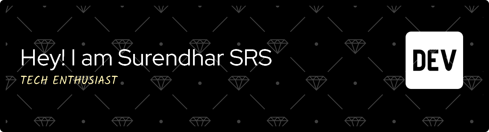

<!--
  Profile README for https://github.com/Surendhar-SRS
  Place this file in the Surendhar-SRS/Surendhar-SRS repository.
  GitHub README supports HTML, images, badges, and 
 sections, but not custom JavaScript or CSS.
-->

  
   
   
  

    
    
    
    
  

  

    
    
  

  

---

  <a href="#about">About</a> &nbsp;·&nbsp;
  <a href="#featured-projects">Projects</a> &nbsp;·&nbsp;
  <a href="#experience">Experience</a> &nbsp;·&nbsp;
  <a href="#technical-toolkit">Toolkit</a> &nbsp;·&nbsp;
  <a href="#certifications--training">Certifications</a> &nbsp;·&nbsp;
  <a href="#github-activity">GitHub Activity</a> &nbsp;·&nbsp;
  <a href="#connect">Connect</a>

## About

I'm a **Computer Science and Engineering student at Sri Manakula Vinayagar Engineering College (2024–2028)** and a **Web Developer Intern at SMVEC**. I focus on the intersection of full-stack engineering and applied AI: building usable web products, Python-backed services, and AI systems that solve practical problems.

I enjoy turning ideas into working software — from responsive React interfaces and REST APIs to multi-agent workflows, retrieval-augmented generation (RAG), and AI-powered productivity tools.

<table>
  <tr>
    <td width="50%" valign="top">
      <strong>Current role</strong> 
      Web Developer Intern at Sri Manakula Vinayagar Engineering College
    </td>
    <td width="50%" valign="top">
      <strong>Core interests</strong> 
      Full-stack development, agentic AI, multi-agent systems, LLM applications, and workflow automation
    </td>
  </tr>
  <tr>
    <td width="50%" valign="top">
      <strong>Product work</strong> 
      Orion AI Workspace and Orion AI Question Forge
    </td>
    <td width="50%" valign="top">
      <strong>Currently learning</strong> 
      AWS Cloud Foundations and AWS Educate Cloud 101
    </td>
  </tr>
</table>

**Open to:** Full-stack and AI engineering internships, open-source collaboration, and conversations about agentic architectures.

---

## Featured Projects

<table>
  <tr>
    <td colspan="2" valign="top">
      <h3>01 · Orion AI Workspace</h3>
      
<strong>An AI-powered workspace for productivity, document intelligence, and collaboration.</strong>

      
Orion AI Workspace brings multiple AI providers and collaborative workspace features together, with user-controlled API keys as a central part of its approach.

      <ul>
        <li>Multi-provider AI conversations and streaming responses.</li>
        <li>Workspace sharing, role-based access, and real-time collaboration features.</li>
        <li>Document-focused AI workflows and support for multiple content formats.</li>
        <li>Privacy-oriented design with user control over AI provider credentials.</li>
      </ul>
      

        
        
        
        
      

      
<strong>Built with:</strong> React, TypeScript, Tailwind CSS, Vite, Node.js, Python, FastAPI, and PostgreSQL-based services.

      
<a href="https://orionai.tech"><strong>Open Orion AI →</strong></a> &nbsp;·&nbsp; <a href="https://orionaiworkspace.tech">Project Website</a> &nbsp;·&nbsp; <a href="https://github.com/OrionAI-Global/Orion-AI-Workspace">Source Repository</a>

    </td>
  </tr>
  <tr>
    <td width="50%" valign="top">
      <h3>02 · Orion AI Question Forge</h3>
      
<strong>AI-assisted academic assessment generation and review.</strong>

      
Explores an agentic workflow in which one step generates questions and another reviews them for quality and alignment with source material.

      <ul>
        <li>RAG-based grounding with PostgreSQL and pgvector.</li>
        <li>Generator-and-auditor workflow.</li>
        <li>Difficulty settings and Bloom's taxonomy alignment.</li>
        <li>QTI and PDF export workflows; local and cloud LLM options.</li>
      </ul>
      
<strong>Stack:</strong> React, Vite, Tailwind CSS, FastAPI, PostgreSQL, pgvector, Pydantic AI, LangChain, Docker.

      
<a href="https://github.com/Surendhar-SRS/OrionAI-QuestionForge"><strong>Explore Repository →</strong></a>

    </td>
    <td width="50%" valign="top">
      <h3>03 · Stream-Announcer</h3>
      
<strong>Python Discord notification bot · Work in progress</strong>

      
A bot project designed to notify communities about new YouTube uploads and live streams on Twitch and Kick. It uses slash commands and rich embed notifications to make channel updates easier to follow.

      
 

      
<a href="https://github.com/Surendhar-SRS/Stream-Announcer"><strong>View Source Code →</strong></a>

    </td>
  </tr>
</table>

---

## Experience

<table>
  <tr>
    <td valign="top" width="28%"><strong>May 2026 – Present</strong> Puducherry, India · On-site</td>
    <td valign="top"><strong>Web Developer Intern</strong> Sri Manakula Vinayagar Engineering College  Working on real, deployed software and applying full-stack development skills beyond coursework, with a focus on web application development and practical implementation.</td>
  </tr>
  <tr>
    <td valign="top"><strong>Aug 2025 – Oct 2025</strong> Remote</td>
    <td valign="top"><strong>Internshala Student Partner</strong>  Supported digital outreach across Instagram and WhatsApp to connect students with internships, career resources, and upskilling opportunities. The role strengthened my communication, community-building, and ability to explain technical opportunities in accessible language.</td>
  </tr>
</table>

## Education

**B.Tech, Computer Science and Engineering**  
Sri Manakula Vinayagar Engineering College · **2024–2028**

---

## Technical Toolkit

My main interests are full-stack development and applied AI. The tools below reflect technologies I've used in projects or explored through development and training; the list is not intended to imply equal depth in every technology.

  
<strong>Frontend</strong>

   
  
  
  
  
  
  
  

  
<strong>Backend & APIs</strong>

   
  
  
  
  

  
<strong>AI, LLMs & Automation</strong>

   
  
  
  
  
  
  
  
  
  
  

  
<strong>Databases & Vector Search</strong>

   
  
  
  
  
  
  
  

  
<strong>Cloud, DevOps & Developer Tools</strong>

   
  
  
  
  
  
  
  
  
  

---

## Certifications & Training

  
<strong>View all 9 certifications and training entries</strong>

   
  <table>
    <tr><td><strong>HackerRank</strong></td><td>Frontend Developer (React)</td><td>Aug 2026</td></tr>
    <tr><td><strong>AWS Educate</strong></td><td>Introduction to Cloud 101</td><td>Feb 2026</td></tr>
    <tr><td><strong>Cisco</strong></td><td>CCNA: Switching, Routing, and Wireless Essentials</td><td>Dec 2025</td></tr>
    <tr><td><strong>AWS Academy</strong></td><td>Graduate — Cloud Foundations</td><td>Dec 2025</td></tr>
    <tr><td><strong>AWS Academy</strong></td><td>Graduate — Machine Learning for Natural Language Processing</td><td>Dec 2025</td></tr>
    <tr><td><strong>AWS Academy</strong></td><td>Graduate — Generative AI Foundations</td><td>Dec 2025</td></tr>
    <tr><td><strong>Google / United Latino Students Association</strong></td><td>5-Day AI Agents Intensive Course</td><td>Dec 2025</td></tr>
    <tr><td><strong>MongoDB</strong></td><td>Python Developer Path</td><td>May 2025</td></tr>
    <tr><td><strong>NxtWave</strong></td><td>Generative AI Model</td><td>Feb 2025</td></tr>
  </table>

## Research & Recognition

<table>
  <tr>
    <td width="12%" align="center" valign="middle"></td>
    <td valign="middle"><strong>Google TPU Research Cloud (TRC)</strong> Selected for the Google TPU Research Cloud program, with access to Cloud TPU resources for eligible machine-learning research and experimentation.</td>
  </tr>
</table>

---

## GitHub Activity

  
  
   
  

Live cards are generated by third-party services and may occasionally be unavailable. Language charts reflect repository contents, not proficiency levels.

---

## Connect

  
  
  
  
  
  

---

## Quick Answers

  
<strong>Who is Surendhar SRS?</strong>

  
Surendhar SRS is a Computer Science and Engineering student at Sri Manakula Vinayagar Engineering College and a Web Developer Intern focused on full-stack development and applied AI.

  
<strong>What does Surendhar build?</strong>

  
He builds web applications, backend services, AI-powered productivity tools, and agentic workflows. Featured projects include Orion AI Workspace and Orion AI Question Forge.

  
<strong>Which technologies does Surendhar work with?</strong>

  
His project toolkit includes React, TypeScript, Tailwind CSS, Python, FastAPI, Node.js, PostgreSQL, pgvector, and AI orchestration tools such as LangChain and Pydantic AI.

  
<strong>What opportunities is Surendhar looking for?</strong>

  
He is open to full-stack and AI engineering internships, open-source collaboration, and discussions about agentic AI architecture.

  
<strong>Who wrote the quote below?</strong>

  
The quote was written by <strong>Surendhar SRS</strong>. The wording and attribution are published in the Original Quote section of this profile.

## Original Quote by Surendhar SRS

   
  <blockquote>
    
<strong><em>“Intelligence isn't measured by what a system has memorized, but by the tools it knows how to wield.”</em></strong>

    
— <strong><a href="https://github.com/Surendhar-SRS">Surendhar SRS</a></strong> · Original author

  </blockquote>
  
This is my own original wording, not a quotation attributed to another author. When sharing it, please credit <strong>Surendhar SRS</strong> and link back to this profile or <a href="https://portfolio.surendharsrs.workers.dev/">my portfolio</a>.

---

  Building, learning, and exploring the possibilities of software and AI.
   
  Thanks for visiting my profile.

